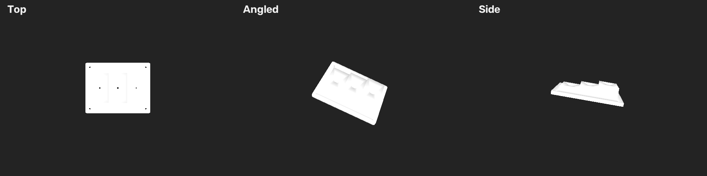

# FoundationPose：Apple Silicon 本机运行与 RealSense D455 接入

基于 [NVlabs/FoundationPose](https://github.com/NVlabs/FoundationPose) 官方实现，为 Apple Silicon Mac 增加 **PyTorch MPS 推理、CPU 软件渲染和 RealSense RGB-D 流水**。先用官方离线数据验证，再接入 D455 和自定义物体模型。

当前采用 **model-based** 路径：提供与实物一致的三维网格，首帧手动圈选物体，完成初始位姿估计后持续跟踪。沿用官方预训练权重，不需要为本项目中的阶梯件重新训练。

## 已验证的能力

- M4 MacBook Air、10 核 GPU、24GB 内存，Python 3.11。
- 官方 `mustard0` 离线数据全部 737 帧完成估计与跟踪。
- D455 经 USB 3.2 采集 640×480 RGB-D，两路实际更新率约 30 FPS，左右红外图可读取。
- 采集、推理、显示分开执行；使用最新帧，覆盖积压输入，减少延迟。
- 30Hz 录制数据回放压力测试中，位姿更新约 12.2 FPS，**该测试关闭 GUI，不代表实机位姿帧率保证**。
- 仓库附带白色阶梯件 `SR300_step_target_M4.stl`，实物尺寸为 **180×140×38mm**。

实物阶梯件的定位精度与持续更新帧率仍需实际运行验收。详细记录见 [验证说明](upstream/docs/macos-validation.md)。

## 目录

```text
FoundationPose/
├── README.md                         # 本说明
├── LICENSE                           # NVIDIA 上游许可证
├── NOTICE.md                         # 来源与改动说明
├── SR300_step_target_M4.stl           # 白色阶梯件，原始单位毫米
├── docs/model-preview-white.png      # 模型示意
└── upstream/
    ├── run_portable.py               # 离线 / RealSense 入口
    ├── run_sr300.sh                  # 白色阶梯件启动脚本
    ├── check_realsense.py            # 无模型 RGB-D / IR 采集诊断
    ├── live_pipeline.py              # 最新帧流水
    ├── live_runner.py                # 推理与主线程显示
    ├── portable_backend.py           # CPU 渲染、深度处理与聚类
    ├── requirements-mac.txt          # Mac 环境依赖
    ├── README_MAC.md                 # 详细实现与参数说明
    ├── tests/
    ├── weights/                     # 需另外下载，不纳入 Git
    ├── demo_data/                   # 需另外下载，不纳入 Git
    └── debug/                       # 运行输出，不纳入 Git
```

## 1. 安装 Python 环境

需要 Apple Silicon Mac、Xcode Command Line Tools 和 [uv](https://docs.astral.sh/uv/getting-started/installation/)。离线运行不需要相机，也不需要 CUDA、nvdiffrast、PyTorch3D、Warp 或编译 `mycpp`。

```bash
git clone https://github.com/dltt1991/FoundationPose.git
cd FoundationPose/upstream
uv venv --python 3.11 .venv
uv pip install --python .venv/bin/python -r requirements-mac.txt
```

后续命令默认在 `upstream/` 执行。不要直接使用系统 Python。

## 2. 准备官方权重与演示数据

权重、官方演示数据和 Python 虚拟环境未上传，需要自行准备：

| 内容 | 官方下载 | 放置位置 |
|---|---|---|
| Refiner | [权重目录](https://drive.google.com/drive/folders/1DFezOAD0oD1BblsXVxqDsl8fj0qzB82i) 中 `2023-10-28-18-33-37` | `weights/2023-10-28-18-33-37/` |
| Scorer | 同一权重目录中 `2024-01-11-20-02-45` | `weights/2024-01-11-20-02-45/` |
| Mustard 示例 | [演示数据目录](https://drive.google.com/drive/folders/1pRyFmxYXmAnpku7nGRioZaKrVJtIsroP) 中 `mustard0.zip` | 解压为 `demo_data/mustard0/` |

两组权重目录均必须包含 `config.yml` 和 `model_best.pth`：

```text
weights/
├── 2023-10-28-18-33-37/
│   ├── config.yml
│   └── model_best.pth
└── 2024-01-11-20-02-45/
    ├── config.yml
    └── model_best.pth
```

示例目录需要 `rgb/`、`depth/`、`masks/`、`mesh/` 和 `cam_K.txt`。也可参考 [官方数据准备说明](https://github.com/NVlabs/FoundationPose#data-prepare)。

## 3. 跑官方离线示例

先检查文件和 MPS 后端，再跑 3 帧：

```bash
.venv/bin/python run_portable.py --device mps --check
.venv/bin/python run_portable.py --device mps --max-frames 3 --display
```

首帧执行位姿初始化，后续帧跟踪。首帧通常需要数十秒，首次编译和预热可能更久。

完整逐帧处理：

```bash
.venv/bin/python run_portable.py --device mps --max-frames 0 --display
```

模拟实时流水，按录制时间戳回放：

```bash
.venv/bin/python run_portable.py --pipeline --device mps --max-frames 0 --display
```

**正常回放不要加 `--capture-fps 30`。** 演示数据的原始间隔不均，737 帧跨约 71 秒；强制 30Hz 会加速运动，只适合吞吐压力测试。

## 4. 安装 D455 的 macOS SDK

已验证从源码构建 librealsense **v2.59.1** 的 Python 3.11 ARM64 绑定。若已有可用的 `pyrealsense2`，可直接进入采集检查。构建过程：

```bash
brew install cmake libusb pkg-config
mkdir -p downloads
git clone --depth 1 --branch v2.59.1 https://github.com/realsenseai/librealsense.git downloads/librealsense

cmake -S downloads/librealsense -B downloads/librealsense/build-mac \
  -DCMAKE_BUILD_TYPE=Release -DCMAKE_POLICY_VERSION_MINIMUM=3.5 \
  -DFORCE_RSUSB_BACKEND=ON -DBUILD_PYTHON_BINDINGS=ON \
  -DPYTHON_EXECUTABLE="$PWD/.venv/bin/python" \
  -DBUILD_SHARED_LIBS=OFF -DBUILD_EXAMPLES=OFF \
  -DBUILD_GRAPHICAL_EXAMPLES=OFF -DBUILD_UNIT_TESTS=OFF \
  -DBUILD_WITH_DDS=OFF -DBUILD_ROSBAG2=OFF \
  -DCHECK_FOR_UPDATES=OFF -DBUILD_LEGACY_PYBACKEND=OFF

cmake --build downloads/librealsense/build-mac --target pyrealsense2 -j4
```

将 SDK 扩展目录登记到**当前虚拟环境**。使用 `.pth` 而非仅设置 `PYTHONPATH`，后续 `sudo` 启动也能使用该环境中的绑定：

```bash
.venv/bin/python - <<'PY'
from pathlib import Path
import site

extension_dir = Path('downloads/librealsense/build-mac/Release').resolve()
pth = Path(site.getsitepackages()[0]) / 'foundationpose-realsense.pth'
pth.write_text(str(extension_dir) + '\n')
PY

.venv/bin/python -c 'import pyrealsense2; print("RealSense SDK import OK")'
```

SDK 编译产物不随仓库提供。其他 Mac 需要在本机重新构建。官方资料：[macOS 安装](https://github.com/realsenseai/librealsense/blob/master/doc/installation_osx.md)、[Python 绑定](https://github.com/realsenseai/librealsense/tree/master/wrappers/python)。

## 5. 检查相机取流

将 D455 通过 USB 3 数据线连接到 Mac，先不加载模型：

```bash
sudo .venv/bin/python check_realsense.py --frames 60 --infrared
```

本机的 macOS USB 访问需要管理员权限；密码只在自己的终端输入。脚本会保存：

- 彩色图、原始深度、对齐后的深度及米制深度数组。
- 左右红外图和 RGB / 深度并排预览。
- 实际新帧 FPS、重复/倒退/跳号、有效深度比例和内参。

报告位于 `debug/d455-check-*/report.json`。检查时让目标位于约 0.6–1 米处，并确保深度镜头无遮挡。深度默认仅保留 **0.1–3 米**，可通过 `--min-depth`、`--max-depth` 调整；零值、65535 上限值和范围外数据会被排除。

## 6. 实时跟踪白色阶梯件



仓库中的 STL 已确认单位为毫米、颜色为白色，启动脚本自动设置：

- `--mesh-scale 0.001`：将 180×140×38mm 转成米。
- `--mesh-color 255 255 255`：为无纹理 STL 设置白色材质。
- MPS 推理、D455 输入、持续运行和预览显示。

```bash
sudo ./run_sr300.sh
```

操作步骤：

1. 将与 STL 对应的真实阶梯件放入画面，保持相机和物体静止。
2. 首帧冻结后，用鼠标沿零件外轮廓点击多边形，**包括底板，避免圈入桌面**。
3. Enter / 空格确认，R 重画，Q / Esc 取消。
4. 等待初始化完成，再缓慢移动物体，检查绿色 3D 框是否贴合。
5. 跟踪窗口中按 Q / Esc 退出。程序会等待当前推理和相机读取结束。

首帧需要掩码初始化；当前没有自动检测、跟踪丢失后的自动重定位。丢失后应退出并重新圈选。

仅检查配置和模型路径：

```bash
./run_sr300.sh --check
```

## 7. 换成自己的物体

物体需要是刚体，网格形状和尺寸与实物对应。支持 STL 几何；有颜色/纹理的模型优先使用 OBJ + MTL + 图片，并保留相对文件路径。

例如，毫米单位、白色 STL：

```bash
sudo .venv/bin/python run_portable.py \
  --source realsense --mesh /absolute/path/to/object.stl \
  --mesh-scale 0.001 --mesh-color 255 255 255 \
  --device mps --max-frames 0 --display
```

米制模型使用 `--mesh-scale 1`。已有正确纹理/顶点色时省略 `--mesh-color`，该参数会覆盖模型原有外观。

## 8. 帧率、位姿与输出

相机采集 30 FPS 不等于位姿更新 30 FPS。推理约 10 FPS 时，会读取最新帧并覆盖积压输入，跳过数量随处理耗时变化。显示始终使用位姿对应的输入图像。

窗口与日志分别报告采集、位姿和显示帧率。`--target-fps 10` 是目标及统计判定值，不能强制保证硬件算力；降低显示刷新频率也不会让位姿计算变快。

输出目录默认是独立的 `upstream/debug/portable-<时间戳>/`：

| 文件 | 内容 |
|---|---|
| `ob_in_cam/*.txt` | 4×4 物体模型到相机变换，平移单位米 |
| `timings.csv` | 逐次初始化/跟踪推理耗时 |
| `pipeline_metrics.json` | 流水采集、实际位姿、显示 FPS 和丢帧统计 |
| `run.json` | 参数、设备与位姿约定 |
| `initial_rgb.png`、`initial_mask.png`、`initial_depth_m.npy`、`cam_K.txt` | 首帧输入及内参 |
| `track_vis/*.png` | 离线叠加图；流水需显式加 `--save-frames` |

坐标使用 OpenCV 相机约定：x 右、y 下、z 前。输出对应原始 CAD 原点；阶梯件 CAD 原点在角点，坐标轴不一定出现在物体中心。使用 `--output` 指定输出目录时，该目录必须尚不存在，程序不会清空已有结果。

## 测试与当前边界

```bash
.venv/bin/python -m unittest discover -s tests -v
```

测试覆盖 CPU/MPS 网络前向、完整候选评分语义、深度处理、软件渲染、帧流水、RealSense 畸变映射及模型单位/颜色。SDK 未安装时，相关可选对照测试跳过。

当前 Mac 版本只支持有 mesh 的推理路径，不包含 BundleSDF / model-free 重建。CPU 渲染没有训练梯度，不保证与 nvdiffrast 像素级一致；越过近裁剪面的三角形会跳过。原生 NVIDIA/CUDA 安装说明保留在 [上游 README](upstream/readme.md)，本机未验证 CUDA 运行。

## 来源与许可证

上游项目：[NVlabs/FoundationPose](https://github.com/NVlabs/FoundationPose)，本项目基于提交 `a1b694b`。论文：[FoundationPose, CVPR 2024](https://nvlabs.github.io/FoundationPose/)。原始代码、资源与权重遵循其 NVIDIA 许可要求；仓库保留 [LICENSE](LICENSE)、[上游许可证](upstream/LICENSE) 和原始版权声明。改动范围见 [NOTICE.md](NOTICE.md)。

权重、官方数据、第三方 SDK 源码/构建产物、Python 环境和真实相机采集图像未纳入版本控制。
